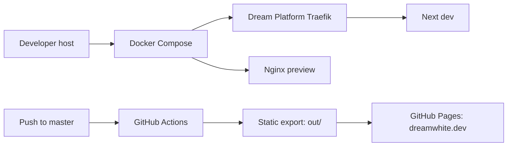

# dreamwhite.dev

Personal website and Markdown writing archive for Ivan Cafiero (`dreamwhite`).

## Stack

- Next.js App Router with static export
- React and strict TypeScript
- Tailwind CSS plus a small custom design system
- Next.js Turbopack and Fast Refresh for local development
- TypeScript 7 for project typechecking
- Markdown content in `content/writing/`
- GitHub Pages deployment through `.github/workflows/deploy.yml`

## Local development

```bash
pnpm install
pnpm dev
```

Validation commands:

```bash
pnpm test
pnpm validate:content
pnpm lint
pnpm typecheck
pnpm build
```

`pnpm check` runs the content validator, typecheck and lint together. The same checks run in the Pages workflow before the static export is uploaded.

TypeScript 7 is exposed through the normal `tsc` command. Next.js uses the project-local compiler for its build and typecheck flow; no separate `tsgo` wrapper or compiler alias is required.

ESLint uses the official Next rule plugin with Babel's TypeScript-aware parser. This keeps linting independent from `typescript-eslint`, whose current stable release does not support TypeScript 7 yet; `tsc` remains the single source of truth for type errors.

Writing is rendered from Markdown through an allowlist-based `rehype-sanitize` pipeline. Raw HTML is parsed only where needed for the existing archive, while scripts, event handlers and unsafe URL protocols are removed before the content reaches the page.

The static output is generated in `out/`.

Personal assets and pending editorial material are documented in [`ASSETS_NEEDED.md`](./ASSETS_NEEDED.md).

The public-facing project set currently includes PRG32, Emporion, an abstracted event-driven MQTT integration, and open-source systems work. A separate personal project is intentionally not published yet.

## Environments

The site has no application backend. There are three deliberate deployment surfaces:

| Surface | Host | Runtime | Entry point |
| --- | --- | --- | --- |
| Local development | `dreamwhite.dream.test` | Next.js dev server with Turbopack | Dream Platform Traefik |
| Static preview | `dreamwhite-prod.dream.test` | Nginx serving `out/` | Dream Platform Traefik |
| Public production | `dreamwhite.dev` | GitHub Pages | GitHub's edge |

The dev and preview profiles use different hosts on purpose. They may run together without competing for the same Traefik router. The public domain is not served by this Compose project.

## Docker + Dream Platform

Both Compose profiles attach only to Dream Platform's external `dream_edge` network. The application does not publish ports to the host and does not need a private application network: the portfolio is a single static site with no service-to-service traffic.

Start Dream Platform first so that `dream_edge` and its Traefik instance exist:

```bash
cd /Users/ivan/dream-platform
./scripts/bootstrap-networks.sh
docker compose -f services/traefik/docker-compose.yml up -d
```

Then, from this repository:

```bash
cp .env.example .env
docker compose --profile dev up --build
```

Development is available at [https://dreamwhite.dream.test](https://dreamwhite.dream.test).

For the production-like static container, which is intentionally exposed on a separate local hostname:

```bash
docker compose --profile prod up -d --build
```

Preview is available at [https://dreamwhite-prod.dream.test](https://dreamwhite-prod.dream.test) when the local DNS zone resolves it. Override `DREAMWHITE_PROD_DOMAIN` in `.env` if the Dream Platform DNS setup uses another name.

Stop either profile with:

```bash
docker compose --profile dev down
docker compose --profile prod down
```

The external network is a prerequisite. If Traefik or `dream_edge` is not running, Compose fails instead of silently exposing the application on a host port. Traefik remains the only service publishing ports 80/443.

Both profiles can be rendered together to inspect the effective configuration:

```bash
docker compose --profile dev --profile prod config
```

## Request security

The local edge and the static preview have different owners for HTTP policy:

- Traefik applies the external `dream-security-headers@file` middleware to both local routers. The middleware belongs to Dream Platform and is not copied into this repository.
- Nginx adds `X-Content-Type-Options`, `X-Frame-Options`, `Referrer-Policy`, `Permissions-Policy`, and hides its version in the production-like preview.
- Next.js no longer advertises its framework through `X-Powered-By`.
- GitHub Pages serves `dreamwhite.dev` independently. Headers configured in Traefik or Nginx do not follow the static files to GitHub Pages and cannot be changed from this repository.

The current static export contains Next.js bootstrap scripts and the inline theme initialiser. A strict CSP cannot be added safely by copying a generic header: it would need a deliberate hash/allowlist strategy for generated inline content or a separate refactor of the theme bootstrap. The repository therefore does not claim a CSP that it cannot enforce consistently. HSTS is likewise an edge/platform policy and must be verified on the public domain rather than inferred from the local preview.

Useful read-only checks:

```bash
curl -ksSI https://dreamwhite.dream.test/
curl -ksSI https://dreamwhite-prod.dream.test/
curl -sSI https://dreamwhite.dev/
find out -type f \( -name '*.map' -o -name '.env*' -o -name '*secret*' \) -print
pnpm audit --prod
```

## CI/CD and rollback

`.github/workflows/deploy.yml` runs on pushes to `master` and can also be started manually. The build job has read-only repository access; only the deploy job receives Pages and OIDC permissions. Dependencies are installed with `pnpm install --frozen-lockfile`, actions are pinned by commit SHA, and the generated `out/` directory is uploaded as the Pages artifact.

To roll back, identify the last known-good commit, create a pull request reverting the bad change, merge it into `master`, and wait for the normal Pages workflow. Verify the deployment at `https://dreamwhite.dev/` and inspect the workflow artifact before treating the rollback as complete.

## Deployment flow



Authentik and other Dream Platform services are not dependencies of this portfolio. They may exist on the shared platform, but this project only requires Traefik and the external `dream_edge` network for local ingress.


